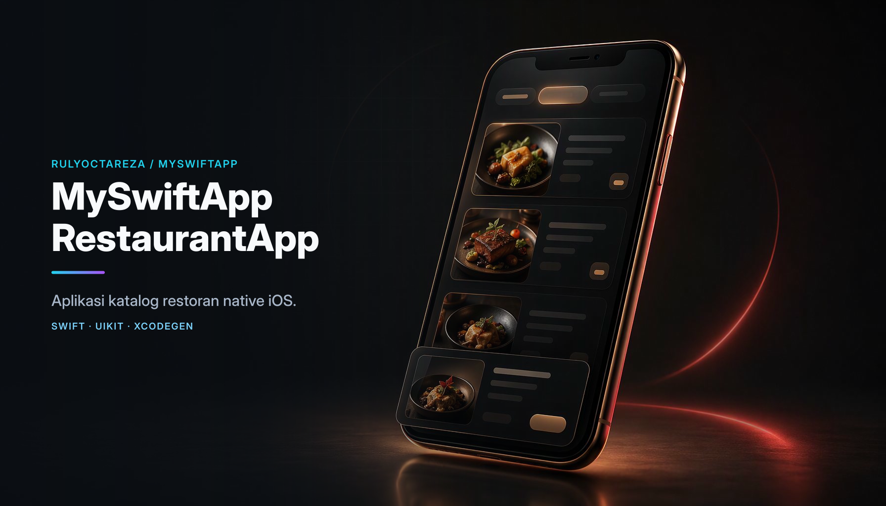
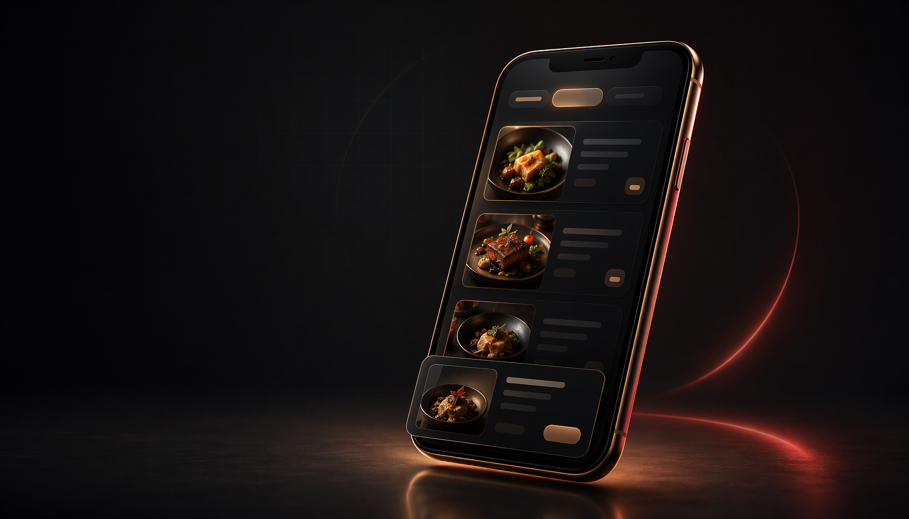

<p align="center">
  
</p>

<h1 align="center">MySwiftApp — RestaurantApp</h1>

<p align="center">
  <b>Aplikasi katalog restoran native iOS.</b><br>
  Swift · UIKit · XcodeGen
</p>

<p align="center">
  
  
  
</p>

---

## ✨ Preview

<p align="center">
  
</p>

<table align="center">
  <tr>
    <td></td>
    <td></td>
    <td></td>
  </tr>
  <tr>
    <td align="center">Home</td>
    <td align="center">Detail</td>
    <td align="center">Profil</td>
  </tr>
</table>

---

## 📖 Tentang

RestaurantApp menampilkan daftar item restoran (minimal 10 item) lengkap dengan gambar dan
judul. Ketuk satu item untuk membuka detail berisi deskripsi dan gambar tambahan, atau buka
halaman About untuk melihat identitas pembuat aplikasi.

---

## 🌟 Fitur

- 🍽️ **Home** — daftar item dengan gambar dan judul
- 🔍 **Detail** — deskripsi dan gambar tambahan
- 👤 **About** — identitas pembuat
- 🧩 Model `Item` dan cell kustom (`ItemCell`)

---

## 🧱 Struktur

```text
RestaurantApp/
├── RestaurantApp/
│   ├── AppDelegate.swift
│   ├── SceneDelegate.swift
│   ├── ViewController.swift
│   ├── DetailViewController.swift
│   ├── AboutViewController.swift
│   ├── Models/Item.swift
│   ├── Views/ItemCell.swift
│   └── Assets.xcassets
├── RestaurantApp.xcodeproj
├── project.yml          # XcodeGen spec
└── Info.plist
```

---

## 🚀 Menjalankan

1. Buka `RestaurantApp.xcodeproj` di Xcode.
2. Pilih simulator atau perangkat fisik.
3. Build & run.

Atau regenerate project dengan XcodeGen:

```bash
xcodegen generate
```

**Kebutuhan:** Xcode 12+, iOS 14+.

---

## 📄 Lisensi

MIT © Fatchurizkia Ruly Octareza
